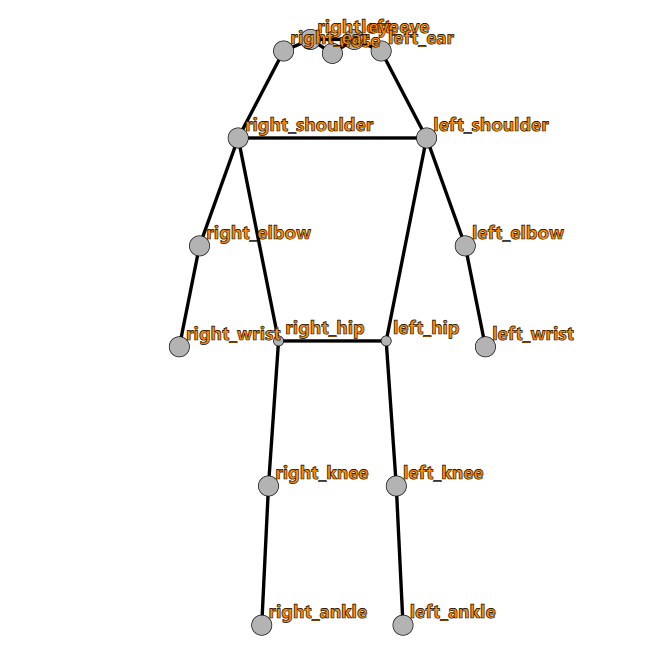
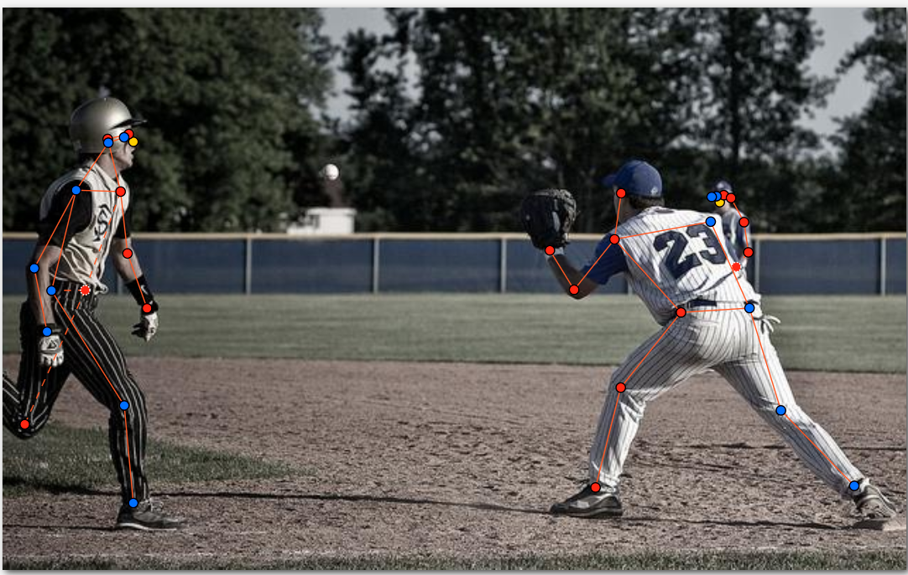
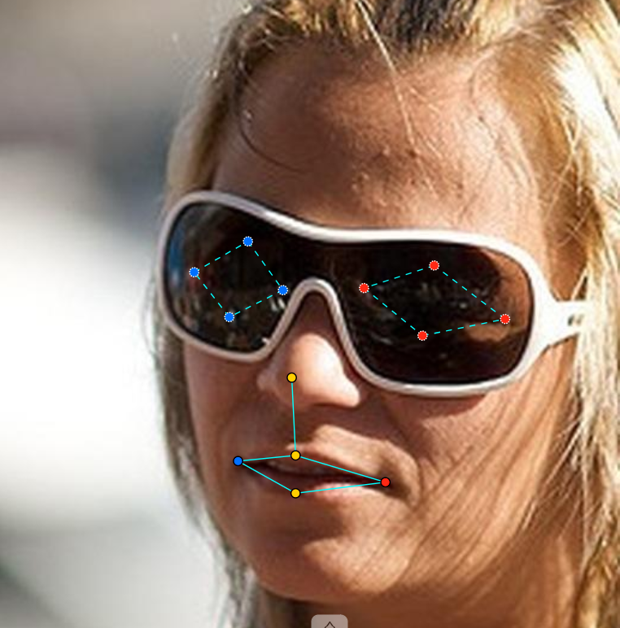
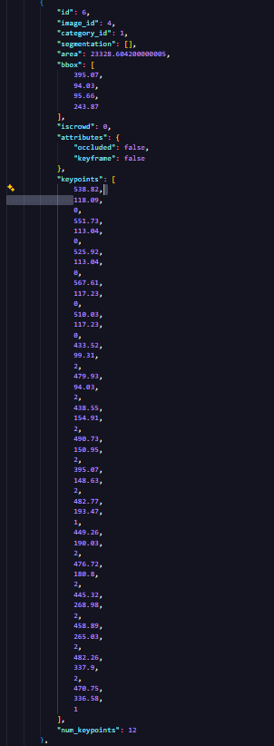

# Báo cáo cá nhân — DoanQuangMinh-2A202603228

Dữ liệu: 12 ảnh người COCO 2017 (Lin et al., 2014) và 8 ảnh khuôn mặt cắt từ ảnh COCO 2017 (CC BY / CC BY-SA), chỉ dùng trong lớp.

## 0. Thông tin học viên

- Họ tên: Đoàn Quang Minh
- MSSV: 2A202603228
- Email: dminh14102005@gmail.com
- Link repository: https://github.com/doanquangminh14/K5-L2-DAY04-DoanQuangMinh-2A202603228-KeypointPose
- Phiên bản CVAT (Help → About): 2.74.1
- Máy: hệ điều hành Windows 11 Home · RAM 24 GB (Docker được cấp 11,5 GB) · chạy CVAT chế độ đầy đủ
- Bộ ảnh (`src/exports/assignment.json` do `lab.py setup` tạo): có
- Giờ bắt đầu: 17:16 ngày 12/11/2026
- Giờ kết thúc: 01:11 ngày 13/11/2026 (lần export cuối, sau khi chuyển 4 job sang completed)

## 1. Kiểm tra label (CP0)

| Label | Kiểu | Số điểm | Tên điểm đúng bảng của lab? | Đúng thứ tự? | Số cạnh |
|---|---|---:|---|---|---:|
| `person` | Skeleton | 17 | Có | Có (`nose` → `right_ankle`, 1 → 17) | 19 |
| `face` | Skeleton | 13 | Có | Có (`left_eye_outer` → `lip_lower`, 1 → 13) | 13 |

Đối chiếu thêm trong file xuất: mục `categories` của cả hai file zip có đúng 17 tên điểm và 19 cạnh (`person`), 13 tên điểm và 13 cạnh (`face`), cùng thứ tự với bảng 1 và bảng 2 trong `docs/GUIDELINE.md`.

Mẫu `person` dựng theo người quay mặt về camera (các điểm `left_*` nằm bên phải khung mẫu)? Có (xem ảnh 6.1)

Cách đổi cờ `occluded` / `outside` cho **một điểm** trên phiên bản CVAT này (một câu):

Rê chuột vào đúng điểm cần đổi (điểm sáng lên) rồi bấm `Q` để bật/tắt `occluded` hoặc `O` để bật/tắt `outside`, hoặc bấm chuột phải vào điểm đó và chọn trong menu; chỉ điểm đó đổi cờ, các điểm khác của skeleton giữ nguyên.

## 2. Số lượng đã gán và thời gian (CP1, CP2)

| Nhóm ảnh | Số ảnh | Số skeleton đã gán | Số người dưới 60 px (không gán) | Số poster / gương / màn hình bỏ qua | Thời gian (phút) |
|---|---:|---:|---:|---:|---:|
| `easy` | 5 | 5 | 0 | 0 | ~22 (gộp `easy` + `occluded`) |
| `occluded` | 3 | 6 | 0 | 0 | (gộp ở dòng trên) |
| `back` | 2 | 5 | 0 | 0 | ~25,5 |
| `small` | 1 | 2 | 6 | 0 | 18 |
| `crowd` | 1 | 3 | 0 | 0 | 7,5 |
| `faces` | 8 | 8 | — | 0 | 19 |

Tổng thời gian job `persons`: 73 phút. Bonus: `persons-extra` 13 phút, `faces-extra` 5 phút.

Ghi chú `small` (000000572411): 6 người dưới 60 px gồm các hành khách ngồi trong toa chỉ lộ đầu và vai (2 người trong số này đã gán nhầm rồi xóa ở bước tự review), người lái trong buồng đầu máy, và 1 người mờ ở hàng ghế sau (không chắc chắn).

Chi tiết số skeleton theo ảnh (lấy từ file xuất):

- `easy`: 000000150500 = 1, 000000294329 = 1, 000000390585 = 1, 000000558066 = 1, 000000564304 = 1
- `occluded`: 000000311497 = 2, 000000521817 = 2, 000000571665 = 2
- `back`: 000000123544 = 3, 000000311300 = 2
- `small`: 000000572411 = 2
- `crowd`: 000000542160 = 3
- Tổng: 21 skeleton `person`, 8 skeleton `face`.

- Số ảnh người đã xong ở mốc phút 105: 10 / 10 (đến 19:01 đã xong cả 12 ảnh người, 8 ảnh mặt và 8 ảnh bonus)
- Mốc hoàn thành: CP1 lúc 18:33 · CP2 lúc 18:41 · CP3 lúc 19:02 (bắt đầu lúc 17:16)
- Ảnh tốn thời gian nhất là ảnh nào, vì sao?

000000572411 (nhóm `small`, khoảng 18 phút), vì người trong ảnh khá nhỏ, phải phóng to tối đa để đặt điểm và đo từng người xem có đủ 60 px không.

## 3. Bảng ca khó (CP1, CP2)

| Ảnh | Người / mặt | Điểm | Cờ đã chọn | Phân vân giữa | Lý do chọn |
|---|---|---|---:|---|---|
| 000000311497 | #2 (tay vợt) | `right_elbow` | 1 | 1 / 0 | Cánh tay phải buông sau thân. Thấy vai và cổ tay ở hai bên chỗ bị che nên đoán chắc được khuỷu. |
| 000000521817 | #1 | `left_ankle`, `right_ankle` | 1 | 1 / 0 | Ngồi xếp bằng, bàn chân bị gối bên kia và vải quần che. Hướng cẳng chân suy ra được từ gối. |
| 000000564304 | #1 | `right_shoulder` | 1 | 2 / 1 | Người cúi, mũ che vai phải, nhưng vẫn thấy cánh tay trên đi ra từ dưới mũ. |
| 000000571665 | #1 | `right_elbow`, `right_wrist` | 1 | 1 / 0 | Tay phải gập sau cánh tay trái đang duỗi. Thấy tay cầm remote nhưng không thấy cẳng tay, nên cổ tay là điểm dễ chọn sai nhất. |
| face_296767 | — | 8 điểm mắt | 1 | 1 / 0 | Kính tối che hẳn mắt. Đoán vị trí theo khóe trong cạnh sống mũi và cỡ mắt trung bình, không theo cỡ tròng kính. |

## 4. Bảng tự review (CP3)

Đi từ ảnh cuối về ảnh đầu. 5 ảnh người (ít nhất 2 ảnh `back` hoặc `crowd`) và 3 ảnh mặt. Ít nhất 8 dòng, kể cả dòng `ok`. Ghi lỗi trước, sửa sau.

| Ảnh | Người / mặt | Điểm | Mã lỗi | Ghi chú | Đã sửa? |
|---|---|---|---|---|---|
| 000000572411 (`small`) | người ngồi trong toa, cao khoảng 38 px | cả skeleton | `extra` | Người dưới 60 px, không được gán | Có, đã xóa |
| 000000572411 (`small`) | người ngồi ngoài cùng bên phải, cao khoảng 43 px | cả skeleton | `extra` | Người dưới 60 px, không được gán | Có, đã xóa |
| 000000571665 (`occluded`) | người thứ hai trong ảnh | cả skeleton | `missing` | Người cao từ 60 px chưa được gán | Có, đã gán thêm |
| 000000311497 (`occluded`) | cậu nhặt bóng đứng sát tường bên trái | cả skeleton | `missing` | Người ở hậu cảnh cao khoảng 290 px, quay mặt về camera, chưa được gán | Có, đã gán thêm |
| 000000542160 (`crowd`) | #3 | `left_knee` ↔ `right_knee`, `left_ankle` ↔ `right_ankle` | `lr_swap` | Người quay mặt về camera, chân không bắt chéo, nhưng gối và cổ chân bị đảo so với đầu và hông | Có |
| 000000521817 (`occluded`) | #2 (cậu bé ngoái đầu) | `left_ear` | `vis_flag` | Tai trái bị khuất nhưng đặt `v = 2` ở giữa hai mắt; đã chuyển sang `outside` | Có |
| 000000311300 (`back`) | #1 | `left_ankle` ↔ `right_ankle` | `lr_swap` | Người quay lưng, hai cẳng chân song song, cổ chân bị đảo | Có |
| 000000311300 (`back`) | #2 (người cầm ô) | `left_ankle` ↔ `right_ankle` | `lr_swap` | Như trên, quần jeans tối màu | Có |
| 000000123544 (`back`) | cầu thủ chạy bên trái ảnh | `left_hip` ↔ `right_hip` | `lr_swap` | Đường vai–hông hai bên cắt chéo thành chữ X; hông bị đảo so với vai | Có |
| 000000123544 (`back`) | cầu thủ đứng sau số 23 | cả skeleton | `missing` | Bị che từ hông trở xuống nhưng cả người cao hơn 60 px; đã gán, phần bị che đặt `outside` | Có, đã gán thêm |
| face_296767 (kính râm) | — | 8 điểm mắt | `position` | 8 điểm trải gần kín tròng kính, mắt cao khoảng 60 px; đã thu nhỏ quanh khóe trong, giữ `v = 1` | Có |
| face_442231 (mặt nghiêng) | — | mí trên, mí dưới, khóe ngoài hai mắt | `position` | Mí trên đặt lên nếp mí / lông mày, mí dưới lên bọng mắt, khóe ngoài lệch xa; đã kéo về sát mép mí. Trái/phải đúng; mắt xa không bị sống mũi che nên giữ `v = 2` | Có |
| face_559185 (mặt thẳng) | — | mí trên, mí dưới, khóe ngoài mắt phải | `position` | Mắt nheo, mí trên và mí dưới cách khe mắt khoảng 10 px; đã kéo sát mép mí, kéo khóe ngoài mắt phải vào | Có |

Tổng hợp số lỗi theo mã:

| `lr_swap` | `vis_flag` | `position` | `missing` | `extra` | `ok` |
|---:|---:|---:|---:|---:|---:|
| 4 | 1 | 3 | 3 | 2 | 0 |

Điểm còn phân vân giữa `v = 1` và `v = 0` (ghi cả hai lựa chọn và lý do chọn):

- 000000571665 #1, `right_wrist`: thấy bàn tay cầm remote nhưng cẳng tay bị cánh tay kia che hoàn toàn, không có đoạn chi ở hai bên để nối nên khó khẳng định cổ tay nằm đâu. Lựa chọn 1: `v = 1`, đặt theo vị trí bàn tay. Lựa chọn 2: `v = 0`, vì không có đoạn chi để nối. Đã chọn `v = 1` vì bàn tay cầm remote nhìn thấy rõ, cổ tay nằm ngay sát bàn tay.
- 000000521817 #1, hai cổ chân: ngồi xếp bằng nên bàn chân bị gối và vải quần che, vị trí chỉ suy ra được từ hướng cẳng chân. Lựa chọn 1: `v = 1`, suy từ hướng cẳng chân. Lựa chọn 2: `v = 0`, vì không thấy trực tiếp. Đã chọn `v = 1` vì hướng cẳng chân từ gối đủ rõ để ước lượng.
- 000000123544 #2 (cầu thủ đứng sau số 23), `left_wrist`: cổ tay trái nằm ngay mép lưng cầu thủ số 23, chỉ lộ một phần rất nhỏ ở vùng ảnh mờ. Lựa chọn 1: `v = 1`, che nhưng đoán được. Lựa chọn 2: `v = 0`, không đoán được. Đã chọn `v = 1` vì phần lộ ra cùng hướng cẳng tay từ khuỷu trái (nhìn thấy) đủ để xác định vị trí.
- face_296767, 8 điểm mắt: kính râm tối che hoàn toàn mắt. Lựa chọn 1: `v = 1`, đoán theo sống mũi và khung kính. Lựa chọn 2: `v = 0`, vì không thấy mắt. Đã chọn `v = 1` theo guideline (kính râm tối trên ảnh màu: bốn điểm mỗi mắt `occluded`), vì sống mũi và gọng kính đủ căn cứ để ước lượng vị trí mắt.

## 5. Kiểm file xuất và kết quả tự kiểm (CP4)

Tự kiểm tay trong file JSON (`annotations/person_keypoints_default.json` trong từng zip):

| File | Người / mặt kiểm (ảnh, thứ tự) | Số phần tử `keypoints` | Điểm `outside` ra `v = 0`, `occluded` ra `v = 1`? | `num_keypoints` khớp? |
|---|---|---:|---|---|
| `DoanQuangMinh_persons.zip` | 000000311300.jpg, người #2 (nhóm `back`, người đàn ông cầm ô) | 51 | Có: `nose`, `left_eye`, `right_eye`, `left_ear`, `right_ear` (outside) ra `v = 0`; `right_wrist`, `left_ankle` (occluded) ra `v = 1` | Có: 17 − 5 điểm `v = 0` = 12 = `num_keypoints` |
| `DoanQuangMinh_persons.zip` | 000000571665.jpg, người #1 (nhóm `occluded`) | 51 | Có: `right_eye`, `right_ear`, `left_knee`, `right_knee`, `left_ankle`, `right_ankle` (outside) ra `v = 0`; `right_elbow`, `right_wrist` (occluded) ra `v = 1` | Có: 17 − 6 = 11 = `num_keypoints` |
| `DoanQuangMinh_faces.zip` | face_296767.jpg (kính râm) | 39 | Có: 8 điểm mắt (occluded) ra `v = 1`; 5 điểm mũi, miệng ra `v = 2`; không có điểm `v = 0` | Có: 13 = `num_keypoints` |

Sau khi xuất, CVAT ghi `occluded` thành `v = 1` và `outside` thành `v = 0`. Tọa độ của điểm `outside` trong file là `0, 0` hay tọa độ cũ? **Tọa độ cũ.** Ví dụ 000000311300.jpg người #2, `nose` = `(538.8, 118.1, 0)`. Chuẩn COCO ghi `0, 0`, nhưng điểm `v = 0` không được dùng khi huấn luyện và khi chấm nên không ảnh hưởng.

Hai job đã chuyển sang completed trên CVAT? Có (cả 2 job chính và 2 job bonus)

Dán phần **TÓM TẮT** in ra từ `src/check_submission.py`:

```text
----- TÓM TẮT (dán vào báo cáo mục 5) -----
- File person: DoanQuangMinh_persons.zip
  Số ảnh: 12 · số skeleton `person`: 21 · mỗi annotation 51 số
  Skeleton theo ảnh: 000000123544=3, 000000150500=1, 000000294329=1, 000000311300=2, 000000311497=2, 000000390585=1, 000000521817=2, 000000542160=3, 000000558066=1, 000000564304=1, 000000571665=2, 000000572411=2
  Cờ v: v=2 274 (77%) · v=1 20 (6%) · v=0 63 (18%)
  num_keypoints trung bình: 14.0
- File face: DoanQuangMinh_faces.zip
  Số ảnh: 8 · số skeleton `face`: 8 · mỗi annotation 39 số
  Skeleton theo ảnh: face_141135=1, face_232598=1, face_296767=1, face_333134=1, face_356144=1, face_442231=1, face_559185=1, face_81239=1
  Cờ v: v=2 96 (92%) · v=1 8 (8%) · v=0 0 (0%)
  num_keypoints trung bình: 13.0
- Ghi chú: 63 điểm v = 0 vẫn mang tọa độ cũ (CVAT 2.x xuất như vậy; chuẩn COCO ghi 0, 0). Không phải lỗi: điểm v = 0 bị bỏ qua khi huấn luyện và khi chấm.
- Số [LỖI]: 0 · số [CẢNH BÁO]: 6
Kết quả: ĐẠT (đọc lại từng cảnh báo ở trên)
```

> ⚠️ Cập nhật lại khối trên bằng kết quả của lần `python lab.py export` cuối cùng (sau khi sửa cảnh báo và Finish job).

Các `[CẢNH BÁO]` còn giữ nguyên và lý do:

| Cảnh báo | Kết luận | Lý do |
|---|---|---|
| 000000123544 #1 (cầu thủ chạy bên trái ảnh): cặp knee ngược phía | Giữ nguyên | Cầu thủ đang chạy, nhìn nghiêng. Chân phải bước lên trước, đúng nhịp với tay trái vung về trước. Gối lệch phía là do sải chân, không phải gán nhầm. |
| 000000123544 #2 (cầu thủ đứng sau số 23): chỉ trải cao 51 px | Giữ nguyên | Cầu thủ ở hậu cảnh bị cầu thủ số 23 che từ hông trở xuống, chỉ thấy đầu, vai trái và tay trái. Phần nhìn thấy cao 51 px, nhưng cả người cao hơn 60 px nên vẫn gán theo guideline (phần bị che đặt `outside`). |
| 000000311300 #1: cặp ankle ngược phía | Đã sửa | Người quay lưng, hai cẳng chân song song, không bắt chéo. Cổ chân trái và phải bị gán đảo, đã đổi lại. |
| 000000311300 #2: cặp ankle ngược phía | Đã sửa | Cùng tình huống: quần jeans tối màu, hai cẳng chân song song. Đã đổi cổ chân trái và phải. |
| 000000311497 #2 (tay vợt): cặp knee, ankle ngược phía | Giữ nguyên | Tay vợt đang bước, xoay 3/4 về phía camera. Chân trái (có dây buộc gối) ở gần camera và bước trước, chân phải nhấc gót phía sau. Gán nhãn đúng. |
| 000000521817 #1: cặp ankle ngược phía | Giữ nguyên | Người đàn ông ngồi xếp bằng, chân bắt chéo thật: mỗi bàn chân nằm dưới gối bên kia. |
| 000000521817 #2: cặp eye, ear ngược phía | Đã sửa tai, giữ nguyên mắt | Tai trái bị đặt giữa hai mắt trong khi thực tế bị khuất; đã chuyển tai trái sang `outside` (`v = 0`), cảnh báo cặp ear đã hết. Cảnh báo cặp eye vẫn còn và được giữ nguyên: cậu bé ngoái đầu nhìn qua vai nên mắt nằm ngược phía với vai là đúng thực tế. |
| 000000542160 #3: trái/phải không nhất quán (ear, hip so với knee, ankle) | Đã sửa | Cầu thủ số 5 đứng thẳng, quay mặt về camera, chân không bắt chéo. Gối và cổ chân bị gán đảo so với đầu và hông, đã đổi cả hai cặp. |
| 000000572411 #1 (người đứng bên phải, cao khoảng 64 px): cặp wrist ngược phía | Giữ nguyên | Người ngồi khoanh tay trước ngực: cổ tay phải nằm cạnh khuỷu tay trái, bắt chéo thật. |

## 6. Ảnh chụp màn hình

1. Label `person` trong label constructor (đủ 17 điểm có tên):

   

2. Một người quay lưng đã gán, cờ đã đặt:

   

3. Một khuôn mặt đã gán 13 điểm, phóng to vùng mắt:

   

4. Một đoạn JSON xuất của một người:

   

Nguồn ảnh: COCO 2017 (Lin et al., 2014), giấy phép CC BY / CC BY-SA.

## 7. Tự đánh giá

1. Lỗi bạn mắc nhiều nhất hôm nay, và cách bạn sẽ tránh ở dự án thật:

   Lỗi mắc nhiều nhất là `lr_swap`, và cả 4 lỗi đều nằm ở nửa dưới cơ thể: cổ chân ở 000000311300 (2 người), gối và cổ chân ở 000000542160, hông ở 000000123544. Nguyên nhân là chỉnh kỹ nửa trên rồi quên đối chiếu chân, nhất là với người quay lưng hoặc đứng sát nhau. Cách tránh: đặt điểm theo từng chi (hông → gối → cổ chân), và trước khi lưu thì nhìn đường nối xem thân hoặc chân có thành hình chữ X không.

2. Một quy tắc bạn đề xuất thêm vào guideline (kèm ảnh ví dụ nếu có):

   Khi người ngoái đầu qua vai, đặt mắt và tai theo hướng của mặt, không theo hướng của thân. Tai ở phía bị gáy che thì để `v = 0`, không đặt đoán vào giữa mặt như lỗi ở 000000521817 #2.

3. Nhãn của bạn đi vào model ở đâu? Chọn một lỗi bạn đã sửa và nói nó sẽ làm model học sai thế nào (heatmap, trọng số trong loss, hay bước lật ảnh):

   Khi đảo cổ chân ở 000000311300, heatmap của `left_ankle` bị dạy có đỉnh ở cổ chân phải. Khi tăng dữ liệu bằng cách lật ảnh, nhãn trái/phải được hoán đổi theo, nên lỗi vẫn sai ở cả hai phiên bản ảnh. Model học được rằng "cổ chân trái có thể ở bất kỳ bên nào", và điểm này trở nên nhập nhằng.

## 8. Khó khăn và lỗi kỹ thuật

- `python lab.py check` chạy ổn: Docker 29.3.1, CVAT 2.74.1, OPA đã nạp quy tắc, không bị lỗi "Connecting…".
- `python lab.py export` chỉ tự kiểm 2 file chính; 2 file bonus được kiểm bằng lệnh `python src/check_submission.py ... --expected-person-images 3 ... --expected-face-images 5`.
- Không gặp lỗi kỹ thuật nào khác (CVAT không treo, không mất dữ liệu, xuất file bình thường).

## Bonus (nếu làm)

### B1 — 3 ảnh người khó thêm

| Ảnh | Số skeleton | Số người dưới 60 px | Ca khó nhất |
|---|---:|---:|---|
| 000000073537.jpg | 2 | 0 | Người đàn ông cầm tranh: hai cánh tay nằm sau khung tranh, chỉ lộ bàn tay ở mép tranh; đã để khuỷu và cổ tay là `outside`. Gối và cổ chân của cả hai người nằm ngoài khung. Lưu ý: người hói ở tiền cảnh (quay lưng, bị cắt khung) chưa được gán |
| 000000188948.jpg | 2 | 0 | Người áo đen nhìn nghiêng: cả nửa trái (mắt, tai, vai, khuỷu, cổ tay, hông, gối) bị thân che, không đoán chắc được nên để `outside`. Người quay lưng: mặt không thấy, 5 điểm đầu để `outside`. Lưu ý: người áo đỏ đứng sau (bị che gần hết thân) chưa được gán |
| 000000517702.jpg | 3 | 0 | Người phụ nữ quay lưng, gối bị váy che (đặt `v = 1`); người ở mép trên bị cắt đầu |

Kết quả `src/check_submission.py` cho `DoanQuangMinh_bonus_persons.zip`:

```text
----- TÓM TẮT -----
- File person: DoanQuangMinh_bonus_persons.zip
  Số ảnh: 3 · số skeleton `person`: 7 · mỗi annotation 51 số
  Skeleton theo ảnh: 000000073537=2, 000000188948=2, 000000517702=3
  Cờ v: v=2 62 (52%) · v=1 3 (3%) · v=0 54 (45%)
  num_keypoints trung bình: 9.3
- File face: DoanQuangMinh_bonus_faces.zip
  Số ảnh: 5 · số skeleton `face`: 5 · mỗi annotation 39 số
  Skeleton theo ảnh: face_102517=1, face_296417=1, face_379585=1, face_494518=1, face_507166=1
  Cờ v: v=2 65 (100%) · v=1 0 (0%) · v=0 0 (0%)
  num_keypoints trung bình: 13.0
- Ghi chú: 54 điểm v = 0 vẫn mang tọa độ cũ (CVAT 2.x xuất như vậy; chuẩn COCO ghi 0, 0). Không phải lỗi: điểm v = 0 bị bỏ qua khi huấn luyện và khi chấm.
- Số [LỖI]: 0 · số [CẢNH BÁO]: 0
Kết quả: ĐẠT
```

### B2 — 5 ảnh khuôn mặt đen trắng / hồng ngoại

Đã gán 5 ảnh (`DoanQuangMinh_bonus_faces.zip`): face_102517, face_296417, face_379585, face_494518, face_507166, mỗi ảnh 1 skeleton 13 điểm (kết quả tự kiểm ở khối B1 phía trên).

Ảnh không màu khó hơn ở điểm nào? Kính râm trên ảnh hồng ngoại có còn là `v = 1` không?

Ảnh không màu khó nhất ở mép môi, vì môi và da cùng tông xám. Mép mí cũng khó thấy vì bóng hốc mắt hòa vào mí. Ở ảnh sepia cũ, vết xước dễ bị nhầm với nếp nhăn. Trong 5 ảnh không có kính râm; chỉ face_102517 đeo kính trong và vẫn thấy rõ mắt, nên đặt `v = 2`. Với ảnh hồng ngoại, ánh sáng IR thường xuyên qua tròng kính râm: nếu trong ảnh thấy được mắt thì là `v = 2`, chỉ khi tròng kính vẫn đục mới để `v = 1`.

### B3 — Model so với nhãn của tôi (không tính điểm)

Không làm.

## 9. Tài liệu tham khảo và công cụ AI đã dùng

- Tài liệu của lab: `README.md`, `RULES.md`, `CHECKPOINTS.md`, `RUBRIC.md`, `SUBMISSION.md`, `docs/GUIDELINE.md`, `docs/CVAT_CHEATSHEET.md`, `docs/COCO_KEYPOINTS.md`.
- Lin, T.-Y. et al. (2014). *Microsoft COCO: Common Objects in Context.* ECCV.
- Công cụ AI: Claude (Claude Code), dùng để:
  - hướng dẫn quy trình làm lab và thao tác CVAT (đổi cờ một điểm, vào trang Job, export);
  - giải thích các `[CẢNH BÁO]` của `src/check_submission.py`;
  - nhận xét vị trí và cờ trên một số ảnh chụp màn hình (ảnh kính râm, người quay lưng);
  - đọc file JSON xuất để điền mục 1, 2 (số skeleton), 5, 9 và trình bày báo cáo.
- Có dùng AI để hỗ trợ viết báo cáo: mục 3, mục 7 và đoạn nhận xét B2 được soạn nháp với sự hỗ trợ của AI; tôi đã đối chiếu với nhãn thật trên CVAT trước khi đưa vào báo cáo.
- Toàn bộ nhãn trên CVAT do tôi tự gán và tự sửa; một số lỗi được phát hiện nhờ cảnh báo của `src/check_submission.py`.
